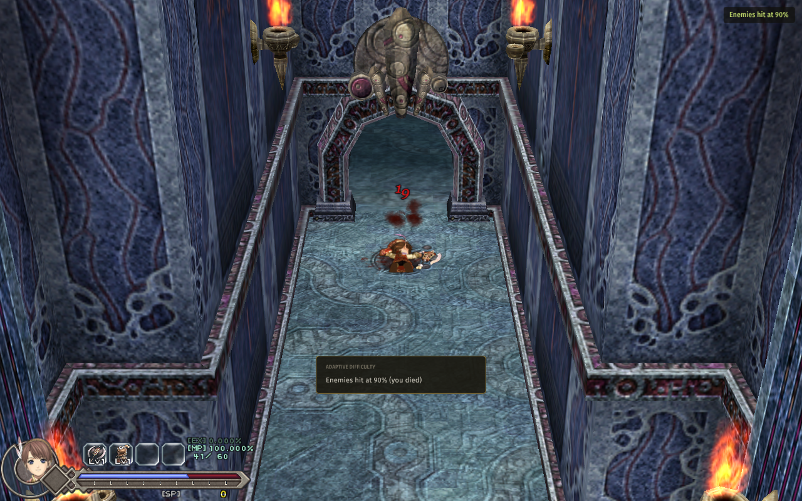

# Adaptive Difficulty

For **Ys Origin** on CleriaCore. Enemies hit a little softer each time you die, and return to normal as you clear
rooms and bosses without dying. Stuck on a boss? The fifth attempt is easier than the first. Past it? The help
fades away by itself.



- **A death** takes one step (10%) off the damage you receive, down to half damage at most.
- **Eight rooms without dying**, or **a boss beaten**, gives one step back.
- **Harder on a streak** (off by default): once back to normal, the same streaks push the damage above normal, up
  to +30%.
- A card tells you each time the damage changes, and a line in the top-right corner shows it while it is not
  normal.

The step, the most help you can get, the rooms per step back and the corner line are settings in
**F1 > Mods > Adaptive Difficulty**, with a *Back to normal* button.

Only the damage **you take** changes. Your own damage, EXP and drops are the game's.

## Install

1. Download `4rtefakt.adaptive-1.0.0.cleriamod` from the [releases](../../releases).
2. Double-click it (or use F1 > Mods > *Install a mod file...*).
3. Turn **Adaptive Difficulty** on in F1 > Mods and restart CleriaCore.

Needs a CleriaCore with mod API 6.

## How it works

One Lua file, [main.lua](main.lua), about 110 lines. The rule itself is one filter:

```lua
cleria.combat.add_filter("damage", function(q)
    if q.dir ~= "taken" or q.value <= 0 then return nil end
    local f = factor()                         -- 1 - level x step
    if f == 1 then return nil end
    return math.max(1, math.floor(q.value * f + 0.5))
end)
```

| Part | API |
|---|---|
| The rule | the `"damage"` combat filter, on hits taken only |
| What moves it | the events `death`, `boss_defeated`, `room_enter` |
| Remembered outside the saves | `cleria.data` (a small JSON file): a death followed by a reload of an older save still counts |
| The card, the corner line, the page | `cleria.notice`, `cleria.hud.layer`, `cleria.ui.page` |

## Tests

`python .dev/run.py` runs six cases through CleriaCore's headless harness, on the engine's own damage: a hit of 21
becomes 19 after one death and a Retry, 17 at two steps, 23 one step above normal; doors bring the damage back up
a step at a time; the state survives a restart; "Harder" off clamps at normal; the mod turned off changes nothing.

Not covered: nobody has played a long session with it, so the default pace (10% a death, 8 rooms a step back) is a
first guess, not a tuned one.

## About

Written with AI assistance (Claude Code) as a showcase of the CleriaCore mod API, and tested as described above.
MIT license.
